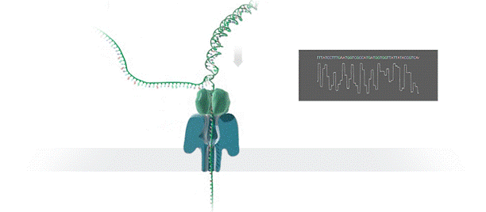
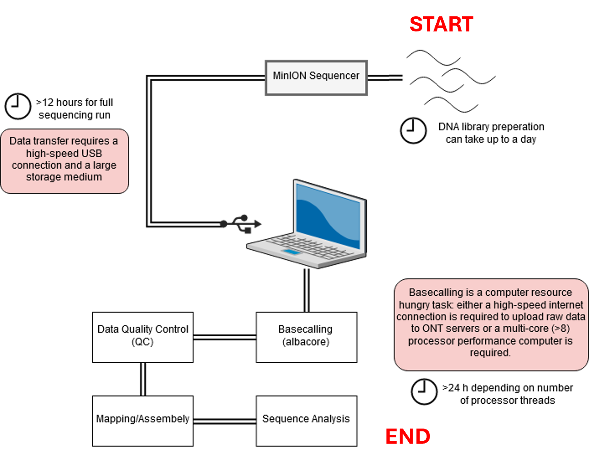

# Oxford Nanopore Technologies (ONT) sequencing recap

---
ONT platforms, rather than the next-generation sequencing-by-synthesis approaches (e.g. Illumina), make use of an array of microscopic protein 'pores' set in an electrically resistant membrane which guide strands of DNA or RNA through them.  

Each nanopore corresponds to its own electrode connected to a channel and sensor chip, which measures the electric current that flows through the nanopore. When a nucleotide passes through a nanopore, the current is disrupted to produce a characteristic 'squiggle'.

  
*ONT nanopore in action. DNA fragment -> 'squiggle' -> basecalling.*

The 'squiggle' is then decoded using basecalling algorithms (e.g. Guppy or Dorado) to determine the DNA or RNA sequence in real time, with a quality score per called base. Oxford Nanopore's most popular platform is the MinION, which is capable of generating up to 20-40 gigabases of sequence data and single reads that are millions of base pairs long!

A complete sequencing run on the MinION platform can generate upwards of 1TB of raw data, and therefore downstream analyses require a significant amount of compute power - multicore high-performance processors and large amounts of RAM (this is the case for all sequence data).

This poses a significant logistical challenge for researchers who want to take advantage of the platform. Luckily, we have access to an HPC cluster (amplicon sequence data, as we have here, also takes up a lot less space than Whole Genome Sequence data).

  
*Figure 1 - A typical sequencing process*

Up until this point you have prepared, sequenced, and basecalled the DNA fragments in your prepared libraries in real-time using the software MinKNOW.

This practical will take you through the next steps - quality control and visualisation, reference-based mapping and consensus generation, and preliminary sequence analysis.