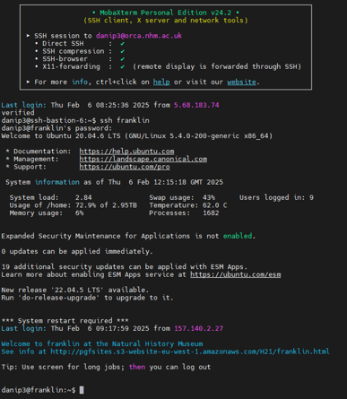

# Prerequisites
{: .no_toc }

<details open markdown="block">
  <summary>
    Table of contents
  </summary>
  {: .text-delta }
- TOC
{:toc}
</details>

---

{: .note }
We recommend typing out all the code as this will help you become familiar with the command line-based bioinformatics.
A small code 'cheat sheet' of useful bash commands can be found in the sidebar.
If you need any assistance at all, please don't hesitate to ask!

---

## Connecting to Franklin HPC

First, let's 'tunnel in' and connect to the Franklin High-Performance Computing (HPC) cluster. This will enable a connection between the computer you are on and the Franklin HPC:


### If you've not connected to Franklin before:
{: .no_toc }

1. Download MobaXterm (portable version)
2. Create a new SSH session (click **Session**, then **SSH**):
   - Remote host: `orca.nhm.ac.uk`
   - Specify username = ticked
   - Enter username in box
   - Make sure X11-forwarding is activated (in advanced SSH settings)
3. Save session with **OK**
4. Open the connection by clicking on the session you just created
5. You should see a login prompt. Make sure the terminal is full screen before entering your credentials, otherwise the QR code will not display correctly. Enter your NHM username and password
6. Download the Google Authenticator app on your phone
7. Scan the QR code with the Google Authenticator app to set up your MFA, press the coloured '+' in the bottom right of the app and scan the QR code
8. Close the connection by clicking the 'X' on the terminal window tab

### If you've accessed Franklin previously, or have completed the steps above:
{: .no_toc }

```bash
ssh -X [YOUR_USERNAME]@franklin.nhm.ac.uk
```

If prompted, enter the verification code (shown on your Google Authenticator app) and type 'yes' to continue, then enter your password when prompted.

Once you've logged in, you should see something like this (please let us know if you're having any trouble):



---

## Setting up the practical

After logging into the NHM's Franklin cluster, we will set up everything for the practical:

### 1. Create a working directory
{: .no_toc }

`mkdir` is used to **m**a**k**e a new **dir**ectory:

```bash
mkdir ONT_practical
```

To see if our directory has been created, we need to use another command `ls` to **l**i**s**t a directory:

```bash
ls
```

Your output should show that your new directory has been created.

### 2. Navigate into your directory
{: .no_toc }

Once we have set up our new directory, we can use the command `cd` to **c**hange **d**irectory:

```bash
cd ONT_practical
```

If you have changed directory successfully, you will notice that your prompt has changed to include your new directory location.

To find where we are, use the command `pwd` which is an abbreviation for **p**rint **w**orking **d**irectory:

```bash
pwd
```

---

## Installing Conda

Install conda (a package and environment manager). We have a custom script to streamline this (it will take a minute or two):

```bash
install-conda
```

Check conda installed correctly using:

```bash
conda --version
```

`conda X.Y.Z` should be output to terminal

```bash
conda activate
```

`(base)` should be appended to the start of your prompt (if it wasn't there already), signifying you have activated the 'base' conda environment.

In this 'base' conda environment, we're going to install mamba (a reimplementation of conda written in C++ that is much faster than conda), using conda:

```bash
conda install conda-forge::mamba
```

Create the conda environment required for this practical from the preconstructed conda_env.yaml file (this file contains an archive of all the tools and packages you will need for the class. It may take ~5 minutes to set up):

```bash
mamba env create -f /hpc/groups/icl-msc-tbe/2026/conda_env.yaml
```

Check that the conda environment was successfully created from the yaml file by running:

```bash
conda env list
```

You should see 'conda_env' below 'base'. And then finally, activate the conda environment using:

```bash
conda activate conda_env
```

'(conda_env)' should replace '(base)' in the terminal prompt