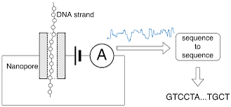
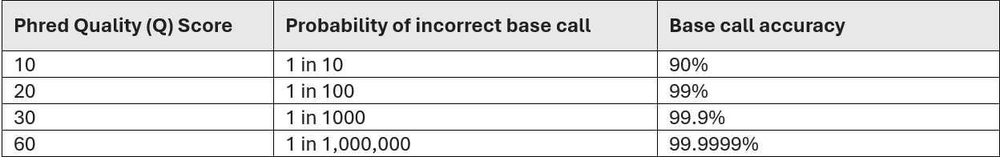

# PART 1: Understanding and locating your ONT amplicon sequence data

---

Each sequenced DNA strand was 'basecalled' to form one read. 

  
*Figure 2 - ONT basecalling process*

There will be multiple (thousands to millions) of reads and their corresponding [Phred (Q) quality score](https://en.wikipedia.org/wiki/Phred_quality_score) encoding stored in a single file, known as a FASTQ file (see the .fastq file extension). This is (generally) the same for all sequencing platforms/technologies.
The FASTQ file is a variation of the FASTA file, which, in addition to containing the sequence after a header line starting with '>', also contains per-base Q scores. So, for example, a sequence in a FASTQ file could be:
```
@M00970:337:000000000-BR5KF:1:1102:17745:1557 1:N:0:CGCAGAAC+ACAGAGTT
GTGCCAGCCGCCGCGGTAGTCCGACGTGGCTGTCTCTTATACACATCTCCGAGCCCACGAGACCGAAGAACATCTCGTATGCCGTCTTCTGCTTGAAAAAAAAAAAAAAAAAAAACAAAAAAAAAAAAAGAAGCAAATGACGATTCAAGAAAGAAAAAAACACAGAATACTAACAATAAGTCATAAACATCATCAACATAAAAAAGGAAATACACTTACAACACATATCAATATCTAAAATAAATGATCAGCACACAACATGACGATTACCACACATGTGTACTACAAGTCAACTA
+
GGGGGGGGGGGGGGGGGGGGGGGGGGGGGGGGGGGGGGGGGGGGGGGGGGGGGGGGGGGGGFGGGFGGGGGGAFFGGFG!GGGGGGFGGGGGGGGGGGGGGFGGG+38+35*311*6,,31=******441+++0+0++0+*1*2++2++0*+*2*02*/***1*+++0+0++38++00++++++++++0+0+2++*+*+*+*+*****+0**+0**+***+)*.***1**//*)***)/)*)))*)))*),)0(((-((((-.(4(,,))).,(())))))).)))))))-))-(
```

Although it looks complicated, the FASTQ format is easy to understand with a little decoding. Each read, representing one sequenced DNA fragment, is encoded by 4 lines:

1. Always begins with `@` followed by the information about the read (i.e. the read header).
2. The actual nucleotide sequence.
3. Always begins with `+` and contains sometimes the same info in line 1.
4. Has a string of characters which represent the quality scores associated with each base of the nucleotide sequence, and must have the same number of characters as line 2. The byte representing quality runs from 0x21 (lowest quality; `!` in ASCII) to 0x7e (highest quality; `~` in ASCII).

These per-base Phred scores are then translated to quality scores for each sequence in the ONT sequencing run. For example, if a sequence got a Phred score of 10, that translates to 1 error in every 10 bases sequenced, 90% accuracy. Every Phred score increase of 10, basecall accuracy increases exponentially.



For ONT specifically, basecalling accuracy has historically been lower than Illumina, with typical Q scores in the Q7-Q20 range for earlier chemistries. However, newer chemistries and base callers (like Guppy with super-accuracy models, or Dorado) can achieve higher Q scores.

You'll have multiple FASTQ files each as MinKNOW outputs a subset of reads to each FASTQ file. You would have set the number of reads you wanted to put to each file during your MinKNOW sequencing run set up.  
These FASTQ files will be located in `/hpc/groups/icl-msc-tbe/2026/`. You can see a list of what's in this directory by typing:

```bash
ls /hpc/groups/icl-msc-tbe/2026/
```

You'll see there are several files, scripts, and directories within it.

Your sequence data can be found within a directory called `/hpc/groups/icl-msc-tbe/2026/DA_30-01-2026_MSc-Imperial-Amplicons/no_sample_id/20260130_1430_X1_FBE55046_905d46ce/fastq_pass/`

This is where the sequence data that passed the minimum score threshold (usually Q10) are stored. This quality score threshold was set in the MinKNOW software when the sequencing run was initiated.

By typing:

```bash
ls /hpc/groups/icl-msc-tbe/2026/DA_30-01-2026_MSc-Imperial-Amplicons/no_sample_id/20260130_1430_X1_FBE55046_905d46ce/fastq_pass/
```

you will see several directories listed under `fastq_pass`, one for each of the barcodes used, and an `unclassified` directory with reads that couldn't be assigned to any barcode (this happens sometimes as adapters and indexes don't always anneal to the end of your DNA correctly).

To enter the directory containing your sequence data, copy the command below (replace `XX` with the barcode number your specimen was assigned):

```bash
cd /hpc/groups/icl-msc-tbe/2026/DA_30-01-2026_MSc-Imperial-Amplicons/no_sample_id/20260130_1430_X1_FBE55046_905d46ce/fastq_pass/barcodeXX
```

As we want to process and analyse all of your sequence data together, the first thing we'll do is concatenate (i.e. combine) all of those FASTQ files into one. This can be done by navigating into the directory containing your sequence data (e.g. barcode01, barcode02, etc.) and running the `cat` command on all of the gzip compressed FASTQ files (i.e. fastq.gz files). 

You can view all these compressed FASTQ files in your `barcodeXX` directory by typing `ls`. You will see there are many of these files.
By specifying `*`, a wildcard character, we can tell the command to concatenate all files with the `.fastq.gz` extension, regardless of the file name. The command below may take a minute to run.

```bash
cat *.fastq.gz > raw_reads.fastq.gz
```

You can check that has worked as intended by typing `ls` and looking for the `raw_reads.fastq.gz` file.

Now we've got our sequence data in one file, we will create a directory where we can copy it to so it's easier to work with. To create a directory called `raw_reads` within your `ONT_practical` directory, type the following command:
```bash
mkdir ~/ONT_practical/raw_reads
```

Even though we were 'in' the directory where your specific sequence data was stored (`/hpc/groups/icl-msc-tbe/2026/DA_30-01-2026_MSc-Imperial-Amplicons/no_sample_id/20260130_1430_X1_FBE55046_905d46ce/fastq_pass/barcodeXX`), by specifying the `~/ONT_practical` path, we tell the computer to create the `raw_reads` directory in our practical directory and not the directory we were currently in.

Now let's copy the `raw_reads.fastq.gz` file to this new `raw_reads` directory, by typing:

```bash
cp raw_reads.fastq.gz ~/ONT_practical/raw_reads
```

This should instantly copy the combined raw sequence data file to the new `raw_reads` directory you created.

Let's navigate back to our practical directory with `cd ~/ONT_practical`, and check that the `raw_reads` directory was successfully created by typing `ls`. 
Double check the file was indeed copied by entering the `raw_reads` directory with `cd raw_reads`, and typing `ls` again.