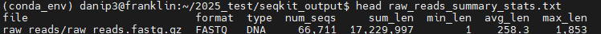

# PART 2: Generating some initial sequence quality metrics

---

Now we have located our sequence data, combined all your sequences into 1 file, and moved it to an area it's easier to work with, we will now check the quality of your FASTQ files to ensure that their data looks good before continuing with any analyses. This quality control (QC) step is the usual first step for all genomic analyses, and is very important.

Quality control steps are similar for any type of sequencing data, although we need to consider that ONT sequences are variable in length, single-ended (unlike most Illumina short-read sequence data that is 'paired-end') as DNA fragments are sequenced 'directly', and has a variable quality profile.

Initially, let's generate some simple summary statistics from our raw sequence data, which can be done using the Seqkit tool. First, let's navigate back to your `ONT_practical` directory (using `cd ~/ONT_practical`) and create a directory for these results to be stored in:

```bash
mkdir seqkit_output
```

Then let's run the `seqkit stats` command to analyse the raw FASTQ file we named `raw_reads.fastq.gz`. Using the `--out-file` argument, we can output the results file to our new `seqkit_output` directory. This should only take a few seconds to run:

```bash
seqkit stats ~/ONT_practical/raw_reads/raw_reads.fastq.gz --out-file ~/ONT_practical/seqkit_output/raw_reads_summary_stats.txt
```

To then view this Seqkit output file, type `cd seqkit_output` to enter the results directory and run the `head` command, which (by default) will look at the top 10 lines of your output files:

```bash
head seqkit_output/raw_reads_summary_stats.txt
```

This should output the contents of the file directly to the terminal, and look something like this:



Most of the column headers are self-explanatory, but:

- `file` = name of the analysed file (e.g. `raw_reads/raw_reads.fastq.gz`)
- `num_seqs` = number of sequences (e.g. 66,711)
- `sum_length` = total length of all bases in FASTQ file (e.g. 17,229,997)
- `min/max/avg_len` = minimum and maximum read length in file, and the average read length

Theoretically, the `avg_len` should be close to your expected amplicon size (i.e. the size of your COI PCR products), and the `min_len` and `max_len` range shouldn't be too wide since you're targeting a specific region.

{: .note }
**[Q]**  
1. How many sequences are in your `raw_reads.fastq.gz` file?  
2. What's the average length of those reads?  
3. Would you say the `min_len` and `max_len` are relatively close together?


