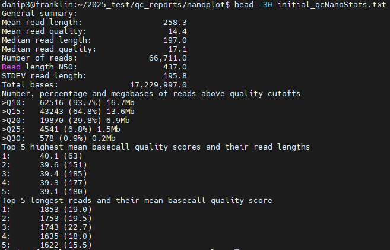
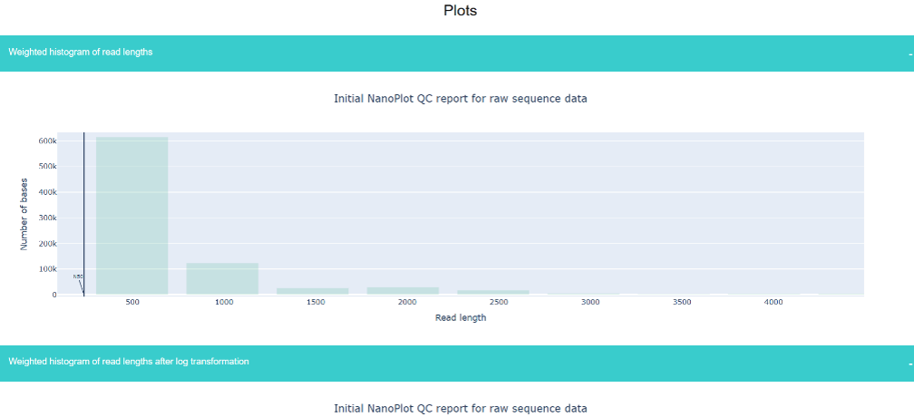

# PART 3: Visualising raw sequence quality

---

The summary statistics generated can only tell us so much, and merely provide a first-pass look at our sequence data. For a more in-depth look at sequence quality, we'll use some widely used tools to visualise our sequence quality and produce some plots.

First, we will return to our home directories again with `cd ~/ONT_practical`, and then we will run [NanoPlot](https://github.com/wdecoster/NanoPlot) on our raw sequence data, using the command below. NanoPlot should only take a few minutes. If you get warnings, do not worry.

```bash
NanoPlot --fastq raw_reads/raw_reads.fastq.gz --outdir qc_reports/nanoplot --prefix initial_qc- --N50 --title "Initial NanoPlot QC report for raw sequence data"
```

With this command, we are first telling NanoPlot that we are inputting a FASTQ file (with `--fastq`), where we want our NanoPlot outputs to go to with `--outdir`, to add the prefix `initial_qc-` to all output filenames, and change the title of the report to something informative. Setting the `--N50` flag tells NanoPlot to annotate all plots with a line at the [N50](https://en.wikipedia.org/wiki/N50,_L50,_and_related_statistics) of your sequence data. Nanoplot is clever, so by specifying `qc_reports/nanoplot` as our output directory (with `--outdir`), it will create the necessary directories and store the results there.

You can view just the summary statistics in the `initial_qc-NanoStats.txt` file, which can be viewed using the command below (remember to type `cd qc_reports/nanoplot` to enter the directory first):

```bash
head -30 initial_qc-NanoStats.txt
```

This should look something like the screenshot below:



You can also view the entire NanoPlot HTML report containing the statistics and all the plots in a web browser. If you have a way of moving the `*-report.html` file to your local computer (e.g. WinSCP, Filezilla, scp), you can visualise the nicely formatted HTML report. It will look something like this:



You will notice at the top of the `initial_qc-NanoPlot-report.html` file, the statistics are the same as those printed directly to the terminal by looking at the top 30 lines of `initial_qc-NanoStats.txt`.

{: .note }
**[Q]**  
Looking at the NanoPlot report statistics and plots:
1. What is the mean read length and quality of your data?
2. How many bases were sequenced in total?
3. What was your read length N50?
4. How many reads (and what percentage) of your data surpassed Q10?
5. Looking at the 'Read lengths vs Average read quality' plots, what can you tell about your sequence data?

