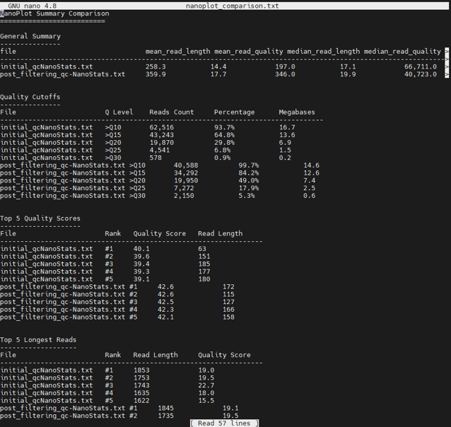

# PART 5: Visualising our quality-controlled sequence data

---

Now we have trimmed and filtered our data to remove poor quality sequences and remaining adapters, let's visualise our quality metrics again using [Nanoplot](https://github.com/wdecoster/NanoPlot). We are roughly using the same command as before, but this time running it on our QC'd data in `trimmed_amplicon/`. This will take a minute to run.

```bash
NanoPlot --fastq trimmed_amplicon/clean_reads.fastq --outdir qc_reports/nanoplot --prefix post_filtering_qc- --N50 --title "Post_QC NanoPlot report for cleaned sequence data"
```

As well as visualising our post-QC sequence metrics, let's compare them with the metrics we generated for our raw reads to see what changed. To start with, we will compare the `NanoStats` summary statistics file, we will do this using a simple custom python script I wrote that parses the quality metrics from both the pre- and post-QC `NanoStats` files into a human-readable format for easy(-ish) comparison.

First, copy the script from `icl-msc-practical-2025` to your practical directory. As you are currently in your practical directory, we can just specify the path to the `nanoplot_summariser.py` script, and denote the current (home) directory with `.` after the path:

```bash
cp /hpc/groups/icl-msc-tbe/nanoplot_summariser.py .
```

Now let's run the script, specifying 3 arguments; the pre-QC file, the post-QC file and the output file name. Because this is a python script, we need to tell our operating system (Linux) to use the python interpreter to execute the script:

```bash
python nanoplot_summariser.py --in1 qc_reports/nanoplot/initial_qc-NanoStats.txt --in2 qc_reports/nanoplot/post_filtering_qc-NanoStats.txt --out qc_reports/nanoplot/nanoplot_comparison.txt
```

Next, move into the `qc_reports/nanoplot` directory from your practical directory (using `cd qc_reports/nanoplot`), and view the created `nanoplot_comparison.txt` file using the file viewer `nano` (`nano nanoplot_comparison.txt`). This file should look something like this:



You can move up and down the file by 'scrolling' or using the arrow keys, and can close the file with `CTRL + X`.

{: .note }
**[Q]**  
What do you notice about your sequence data pre- (initial) and post-QC (post_filtering)?
1. How did the mean and median read lengths change, and why?
2. Did the mean and median read quality go up or down?
3. What percentage of reads are >Q10 between the pre- and post-QC statistics?
4. How many reads did we discard during our trimming and filtering QC (look at the `read_counts` column)?
5. How many bases were 'lost' due to these reads being discarded (look at the `total_bases` column)?
6. Did your N50 go up or down?
7. Overall, do you think things improved by conducting these quality control steps?