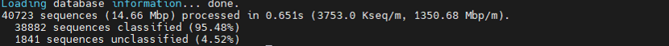
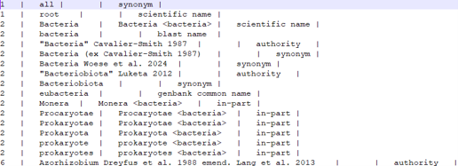
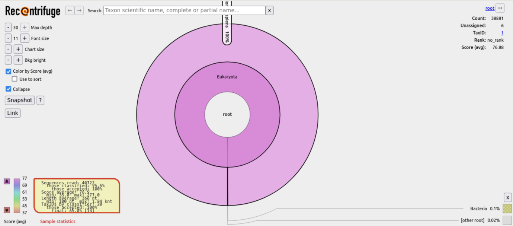

# PART 6: Final QC using Kraken2 to screen for 'contaminant' sequences

---

Before proceeding any further, we will undertake a final quality control step - verifying the 'purity' of our sequence data. In this section, we will use [Kraken2](https://github.com/DerrickWood/kraken2/wiki), a rapid and memory-efficient, [kmer](https://en.wikipedia.org/wiki/K-mer)-based taxonomic classification system, to identify and remove potential contaminant sequences in our data. As we are working on museum specimens, contamination screening is particularly important!

This quality control step serves two important purposes: it allows us to evaluate the effectiveness of our DNA extraction, enrichment, and sequencing protocols, while also preventing off-target sequences from contaminating our final dataset and potentially skewing our analyses. By identifying and removing non-target organism sequences, we can ensure the reliability of our subsequent analytical steps.

In the interest of time, prior to your practical I downloaded the (8GB subset version of the) standard [Kraken2 database](https://benlangmead.github.io/aws-indexes/k2) to `/hpc/groups/icl-msc-tbe/databases/`. Capping the database to 8GB does come at the cost of some sensitivity and accuracy, but for our purposes (and so we are not sleeping here tonight), it's suitable.

This database essentially contains a taxonomy tree representing the hierarchical relationships between different organisms, and reference genomic sequences of common contaminants including archaea, bacteria, viruses, plasmids, vectors ([UniVec](https://www.ncbi.nlm.nih.gov/tools/vecscreen/univec/)), and the human genome. Kraken2 will then essentially sift through the reads in your FASTQ file and crosscheck them against the genomic sequences in the database.

First, make sure you are back in the practical directory (using `cd ~/ONT_practical`), then let's create a directory for all the outputs of the Kraken2 analysis to be sent to.

```bash
mkdir kraken2_screen
```

Now enter the `kraken2_screen` directory and run Kraken2 (using the command below) to screen and classify your reads against the reference sequences in the database.

`k2_standard_08gb_20240904` is the kraken2 database we'll be screening our sequence data against. It is stored in the `icl-msc-tbe/databases/` directory. Here, we're telling kraken2 to run on our 'cleaned' (adapter and quality trimmed reads) with `../trimmed_amplicon/clean_reads.fastq`.

```bash
kraken2 --db /hpc/groups/icl-msc-tbe/databases/k2_standard_08gb_20240904/ --output kraken2_output.txt --report kraken2_report.txt --classified-out classified.fastq --unclassified-out unclassified.fastq ../trimmed_amplicon/clean_reads.fastq
```

- `kraken2_output.txt` and `kraken2_report.txt` represent the raw and curated taxonomic assignment outputs, respectively.
- `classified.fastq` includes those sequences from our 'cleaned' sequence data that matched with one or more of the contaminant organisms in the database, while those in `unclassified.fastq` contain those sequences with no matches to genomes in the database. It's these unclassified reads we are interested in taking forward for analysis.

Kraken2 will take a few minutes to run. You should see some progress information output to the terminal, and some summary statistics on the number of sequences classified, such as in this example below:



The report file will contain a more in-depth view of which organisms your sequence data matched to and their taxonomic hierarchies - This file isn't particularly easy to interpret, so we will use a program called [Recentrifuge](https://github.com/khyox/recentrifuge) to manipulate and plot these results.

First, we need to download the entire NCBI taxonomy as a requirement of Recentrifuge. But let's make a new directory called `rcf` to store the results, using:

```bash
mkdir rcf
```

Now let's run the Recentrifuge tool.

- `-n` tells the tool where the taxdump is stored. The taxdump is a collection of files representing a snapshot of NCBI's entire taxonomy database. I have pre-downloaded this for you, in this case the taxdump is from January 2025. Recentrifuge needs two files in the taxdump, `nodes.dmp` and `names.dmp`, which collectively form a sort of taxonomic tree we will match against (see below top of names.dmp)



- `-k` specifies that we want to run Recentrifuge on our kraken2 output file, which is 'back'/'up' one directory (hence `../`)
- `-o` tells the tool where to output the results file to (our current directory (`rcf/`))
- `--extra` tells the tool we want an additional output in CSV format, and `--summary ONLY` specifies we want a summary CSV file output.

```bash
rcf -n /hpc/groups/icl-msc-tbe/databases/taxdump-2025-01-01/ -k ../kraken2_output.txt -o rcf_result.html --extra MULTICSV --summary ONLY
```

Once it's finished running let's view the results. Type `ls` and you will see a HTML file of the visualisation, and a `.csv` file containing summary information behind the plot.

Now, let's run the `head` command (20 lines should be enough) to view our `rcf_results.stats.csv` summary file:

```bash
head -20 rcf_result.stats.csv
```

If you are able, transfer the HTML file to your local computer folder in WinSCP and open it to view the visualisation in a web browser. The HTML file should look something like this:



{: .note }
**[Q]**  
How do you think the contamination screening went overall?
1. How many sequences were analysed by Recentrifuge in total?
2. What percentage of your reads were classified as contaminant, and how many reads are remaining (i.e. unclassified)?
3. How many unique TIDs (taxonomic IDs (i.e. taxa)) were the classified (i.e. contaminant) reads matched to?
4. What organism made up the largest proportion of detected contaminant sequences (requires HTML)? How many sequences were assigned to this organism?
5. What other organisms were your sequences also classified to?
6. Where do you think these contaminants came from, and how do you think they may have got into your sequenced sample?
7. Do you think taking the `unclassified_reads` (output by Kraken2) forward for further analysis is a fool proof way of screening ALL possible contaminants?

Once you are done, you can return to your practical directory (`cd ~/ONT_practical`).

---

## Optional: Taxonomically assign your reads against a different database

Taxonomically assign your reads against a different database using Kraken2 to compare the number of classified sequences. This time we will run Kraken2 using the 16GB plusPF database. The 'plusPF' is built on the standard database, in this case the 16GB version, and includes additional sequences representing protozoal and fungal sequences. Fungal sequences are nearly always present in museum specimens, so it's always a good idea to screen for fungi when working with samples from the collections!

First create a new directory for these results, with:

```bash
mkdir kraken2_screen-pluspf
```

Then you can run Kraken2 using this database with this command, substituting the previous database for the plusPF one (this will take a little longer than the previous command, ~5-10 minutes):

```bash
kraken2 --db /hpc/groups/icl-msc-tbe/databases/k2_pluspf_16gb_20240904 --output ./kraken2_screen-pluspf/kraken2_output.txt --report ./kraken2_screen-pluspf/kraken2_report.txt --classified-out ./kraken2_screen-pluspf/classified.fastq --unclassified-out ./kraken2_screen-pluspf/unclassified.fastq ./trimmed_amplicon/clean_reads.fastq
```

If you're feeling particularly motivated, you can also rerun the Recentrifuge commands above on these new Kraken2 (plusPF) outputs and answer the questions below. Remember to change your paths in the Recentrifuge command to the new `kraken2_screen-pluspf/` kraken2 output file.

{: .note }
**[Q]**  
How did this Kraken2 run differ from the last?
1. Were greater or fewer reads classified than when running Kraken2 with the standard 8GB database?
2. Were any organisms detected in the 'plusPF 16GB run' that weren't detected in the 'standard 8GB run'?