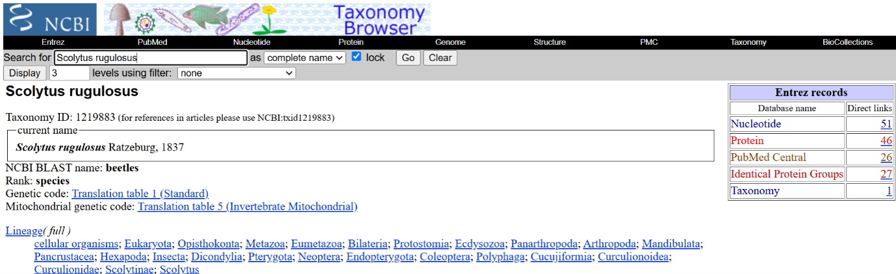
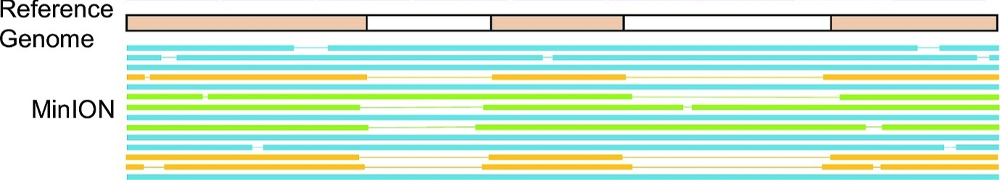
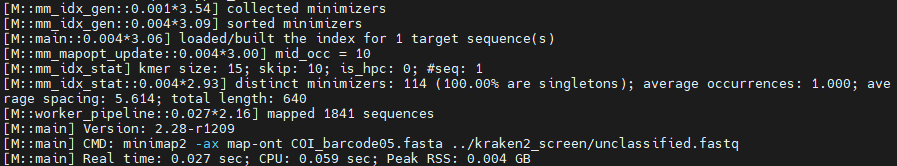
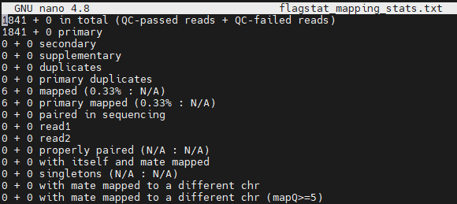
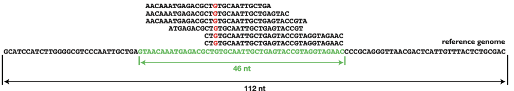
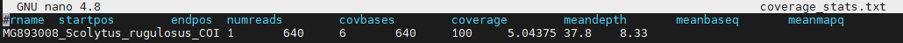
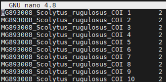
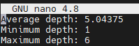

# PART 7: Mapping your amplicon data to a COI reference sequence

---

Now that we have verified your sequencing runs were successful, our robustly quality controlled sequence data is ready for mapping and downstream analysis.
We will now map the reads on to several different COI reference sequences that might represent your target organism. The COI reference sequences have already been downloaded for you from the [NCBI's GenBank Nucleotide database](https://www.ncbi.nlm.nih.gov/genbank/) - a curated database of all publicly available DNA sequences) to streamline things. COI reference sequences were downloaded by searching the name of your specimen, determined based on morphology, in [NCBI's taxonomy database](https://www.ncbi.nlm.nih.gov/datasets/taxonomy/).


*Example NCBI taxonomy entry*

'Nucleotide' was then selected from the species' database record (see above, on the right-hand side), which takes us to all the nucleotide sequences associated with that species, if any are available (in this example there are 23). These sequences were then filtered for mitochondrial sequences and the longest available COI sequences available were downloaded in FASTA format.
For some specimens, only partial coding sequences for COI could be downloaded for the specimen due to a lack of representation in the database. This shouldn't be too much of problem though, as for all specimens the ~600 bp barcoding region of COI was available.

This practical refers to 'mapping' reads, which is the same as 'aligning' reads to the reference - A mapped read file for ONT data may look something like the diagram below, where reads of different lengths are matched (based on sequence similarity) to the reference sequence, and their start and end position (relative to the reference) are recorded.



If a reference for your specimen, or a closely-related species, is not available, then you could go about a de novo assembly [de novo assemblers](https://en.wikipedia.org/wiki/De_novo_sequence_assemblers) apply a similar process but without the use of a reference sequences to map reads against.

As with previous steps (and making sure you are in your practical directory), let's first create a directory for all of the files generated during reference mapping to go into using the following command:

```bash
mkdir mapping
```

Now enter the new `mapping` directory (using `cd mapping`). You will now need to copy the COI reference sequences for your specific sample from the `/hpc/groups/icl-msc-tbe/2026/coi_refs/` directory into your newly created `mapping` directory.
As you are working with specimens from an ongoing research project, and due to morphological uncertainty (they could only be identified to family-level), you will have several COI FASTA reference sequences from a couple of different species within the specimens family to increase taxonomic diversity, and thus offset the uncertainty with the morphological identification (in theory).
You can copy your required references with the command below, where you will need to change `[SPECIMEN_NAME]` to your specimen's taxonomic identification (e.g. Scarabaeidae):

```bash
cp /hpc/groups/icl-msc-tbe/2026/coi_refs/[SPECIMEN_NAME]_*.fasta .
```

Double check the reference has been correctly copied by typing `ls`, and looking for `[SPECIMEN_NAME]_*.fasta`. Remember that the asterisk (`*`) represents a wildcard character (e.g., '1', '2', '3').

For mapping our reads to the reference sequence, we'll use the tool [minimap2](https://github.com/lh3/minimap2). Minimap is a fast, versatile sequence alignment tool that can align many different types of sequence data to a reference genome, and can align a genome to another genome. We will map our reads to each of your references one-by-one, and compare the outputs.

To run minimap and align ONT reads, we need to specify the `map-ont` parameter. This preset lets minimap know we are working with ONT data so it can adjust its alignment settings to account for ONT's specific error patterns.
Alternatively, if you were working with Illumina data you could set `sr` (short reads), or for PacBio data you'd set `map-pb`. To use any of these presets, we must also set the flag `-x`.
Setting the `-a` flag tells minimap we want our mapped read file output in [SAM](https://en.wikipedia.org/wiki/SAM_(file_format)) ('Sequence Alignment Map') format. SAM is a human-readable text format file (similar to FASTQ) with 11 mandatory fields representing mapping metadata, including information like the start and end position of the mapped read, mapping quality, and the mapped sequence itself.

Run the minimap2 command below to map your unclassified (i.e. trimmed, cleaned, decontaminated) reads against your first reference sequence. This should run relatively quickly as the reference is small, at least in comparison to a full genome (remember to replace `[REF_FILENAME]` with the filename of each of your reference sequences):

```bash
minimap2 -ax map-ont [REF_FILENAME].fasta ../kraken2_screen/unclassified.fastq > [REF_FILENAME]-mapped_reads.sam
```

You will see some logging information and statistics from minimap2 output to your terminal, such as below:



We can have a look at a snippet of this SAM file using the following command to view the 'head' of the file (not that it will mean much to our eyes):

```bash
head [REF_FILENAME]-mapped_reads.sam
```

Now we have done our initial mapping, we'll need to do some processing of the mapped reads. We can use a toolkit called [Samtools](https://github.com/samtools/samtools) for this, which as the name suggests, is a collection of tools for interacting and manipulating SAM (Sequence Alignment/Map) and BAM files.
BAM is just a binary version of SAM, with all the same information but compressed to keep file sizes small, this makes working with mapped read files much faster (and saves valuable storage space).
We'll use the `view` command to convert our SAM to a BAM format, in conjunction with the `b` flag. We'll also set the `-S` to tell samtools our input file is in SAM format.

```bash
samtools view -bS [REF_FILENAME]-mapped_reads.sam > [REF_FILENAME]-mapped_reads.bam
```

You could then remove/delete the SAM version of the file to tidy things up and recover some storage capacity, but we'll leave it for now. As we now have our mapped reads in BAM format, we are going to sort and index the file for more efficient (and thus even quicker) access by using the `samtools sort` and `samtools index` commands. To use `index` for fast look-up of mapped reads against the reference, the mapped reads in the BAM file must first be sorted based on their positions against the reference. These commands should take a couple of seconds each.

```bash
samtools sort [REF_FILENAME]-mapped_reads.bam > [REF_FILENAME]-mapped_sorted.bam
```

```bash
samtools index [REF_FILENAME]-mapped_sorted.bam
```

At this point, we can use the `flagstat` samtools command to print summary mapping statistics from the indexed BAM file:

```bash
samtools flagstat [REF_FILENAME]-mapped_sorted.bam > [REF_FILENAME]-flagstat_mapping_stats.txt
```

Let's view the file to see how the mapping went using the `head -20` command, followed by the `[REF_FILENAME]-flagstat_mapping_stats.txt` file.

The `flagstat` output should look something like this:



Where each line specifies:

1. Total number of reads in BAM file (passed mapping quality thresholds + those that failed)
2. Duplicates
3. Number of mapped reads
4. \*Paired reads in sequencing
5. \*Number of forward reads
6. \*Number of reverse reads
7. \*Number of properly paired reads
8. \*Number of reads mapped along with their mates
9. \*Singletons: number of reads mapped alone, i.e. mate not mapped
10. \*Reads whose mates are mapped to a different chromosome
11. \*Reads whose mates are mapped to a different chromosome with mapping quality greater than 5

{: .note }
N.B. Bear in mind we are working with single-direction ONT amplicon reads and not paired-end Illumina reads therefore the lines starting with `*` are not applicable for ONT data and can be ignored.

Next, we will get an insight into the two 'types' of sequence coverage against the COI reference sequence we mapped our reads to  these are 'coverage', or the percentage of the reference sequence covered/mapped by our reads, and 'coverage depth' or the number of times the whole reference sequence is represented by a set of reads.

For example, looking at the diagram below, 'coverage' would be 46 bases (nt) out of 112 nt in the reference. Therefore, 'coverage' here would be ~40%.
'Coverage depth', on the other hand (just focusing on the 'G' bases in red), would be 6x because 6 reads stack on top of one another to represent the 'G' base in the reference sequence 6 times.
In both cases, these measures can give us a good indication into how thoroughly that region was sequenced, and therefore our confidence in the mapped reads.



Let's analyse both the coverage and coverage depth of our mapped reads to the COI reference sequence(s). Together, the commands below will give you a comprehensive view of:

- How well your reads mapped to the reference(s) (along with the flagstat output you have already generated)
- Which regions of the reference sequence have good/poor coverage of the reference (i.e. coverage, e.g. did they all 'stack up' in one region, or do they represent the reference well?)
- How well represented the reference sequence's covered bases are (i.e. coverage depth)
- Any potential biases or issues in the sequencing/mapping

Make sure you are in the `mapping/` directory before running the commands. First off, run `samtools coverage`, stating our input mapped reads BAM file and the name and output location of our output stats:

```bash
samtools coverage [REF_FILENAME]-mapped_sorted.bam > [REF_FILENAME]-coverage_stats.txt
```

When viewed, the file will look something like:



By running `samtools depth`, we can get a slightly different look at coverage depth across the reference sequence we mapped our reads to. By setting the `-a` flag, the command will output per-base coverage depth across the entire reference sequence, whether reads were mapped to that region or not. Again, we'll use our mapped reads in BAM format:

```bash
samtools depth -a [REF_FILENAME]-mapped_sorted.bam > [REF_FILENAME]-depth_per_base.txt
```

When viewed, the file will look something like:



We can also use complicated bash syntax, such as in the lines of code below, to determine the average, minimum and maximum coverage depth of our mapped reads against the reference, and output them to a file called `avg_depth.txt`.
`echo` is a bash command that prints the text "Average depth:" to an output file named `avg_depth.txt`, whilst also creating that file. The next line then runs the `samtools depth` on our data and 'pipes' (using `|`) the output to the `awk` command, which adds up the values in the third column of our 'depth' output (using `sum+=$3`), and then prints the average, minimum and maximum of those values to the `avg_depth.txt` file we just created, using `>` to append it to the file.

```bash
echo "Average depth:" > avg_depth.txt
```

```bash
samtools depth -a [REF_FILENAME]-mapped_sorted.bam | awk ' BEGIN {min=999999; max=0; sum=0; count=0} { sum+=$3; count++; if($3>max) max=$3; if($3<min) min=$3 } END { print "Average depth: " sum/count; print "Minimum depth: " min; print "Maximum depth: " max }' > avg_depth.txt
```

When viewed (with `head -20`, `nano` or `more` commands), the file will look something like:



There's no shortage of ways to analyse our sequence data, both using samtools and the plethora of other tools out there!

{: .note }
**[Q]**  
Looking at the outputs of each command (using the `nano` command followed by the filename), answer the following questions:
1. How long was the COI reference sequence?
2. How many reads mapped to the reference? Is this the same number as you got in the (flagstat) mapping statistics?
3. How many bases in the reference were covered by your reads (i.e. what was the 'coverage'?), and what percentage does this amount to?
4. What was the average depth of coverage across the reference?
5. What was the minimum and maximum depths? Is the coverage depth highly variable or uniform across the reference sequence?