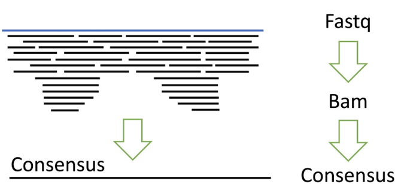
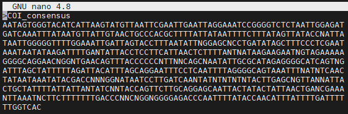

# PART 8: Generating a consensus sequence

---

Next, we're going to create a consensus sequence from our reads mapped to the 'best' reference sequence (whichever reference had the highest number of reads mapped and/or highest average coverage depth). This step is necessary as it provides us with a single FASTA file containing one (consensus) sequence representing all of the reads that mapped to our reference (in the BAM file). A consensus sequence is essentially a concatenation of all reads into one, as shown in the diagram below:


*Diagram of creating a consensus sequence from reads mapped to a reference sequence.*

We can convert BAM to FASTA format and create a consensus in one step using `samtools`. The command below will create the consensus sequence from your mapped reads, and then change the sequence header of your consensus sequence to `COI_consensus` (as it is default called the name of the reference file, which can get confusing). Your FASTA formatted consensus sequence will be saved to the same directory as the BAM format file.

```bash
samtools consensus -f fasta [REF_FILENAME]-mapped_sorted.bam | sed '1s/.*/\>COI_consensus/' > [REF_FILENAME]-COI_consensus.fasta
```

You can view the consensus sequence file you have created using `nano`, which should look something like this:



As the first line starts with `>`, followed by the name of the file, we know it is a FASTA file. Notice how some bases are `N`, representing an ambiguous base, and meaning that either no read was mapped to that base in the reference sequence (i.e. it was empty/a gap and so an `N` was inserted) or the reads that mapped over that base had different basecalls at that position (e.g. one read had a `G` and one read had a `T`). As in the example above, hopefully most of your consensus sequence is represented by `A`, `T`, `C` or `G`!