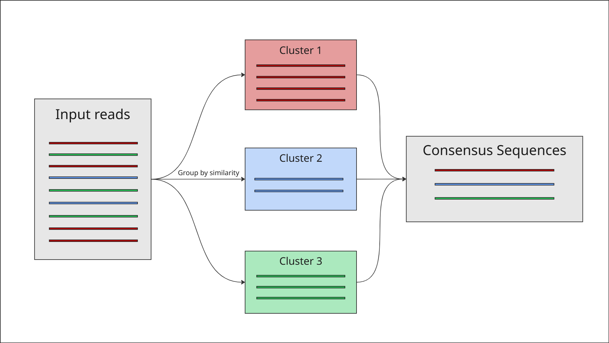
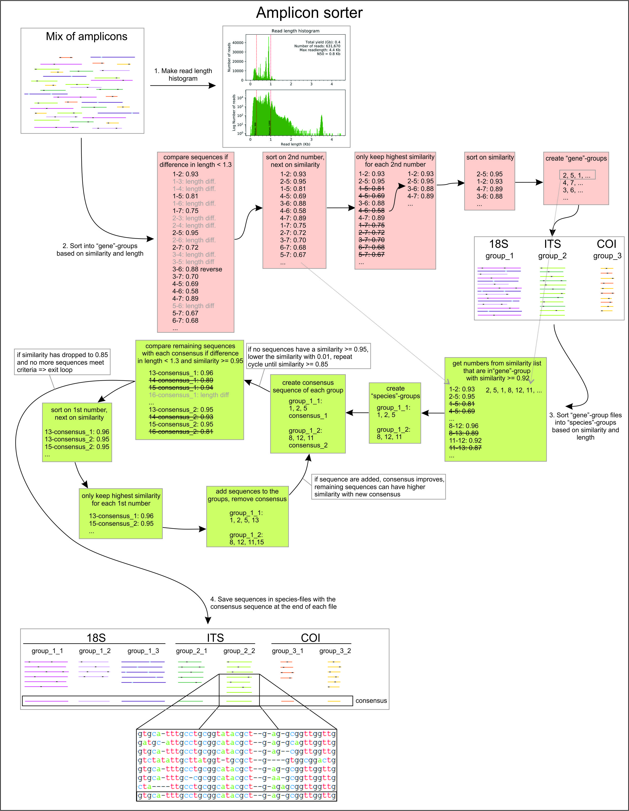
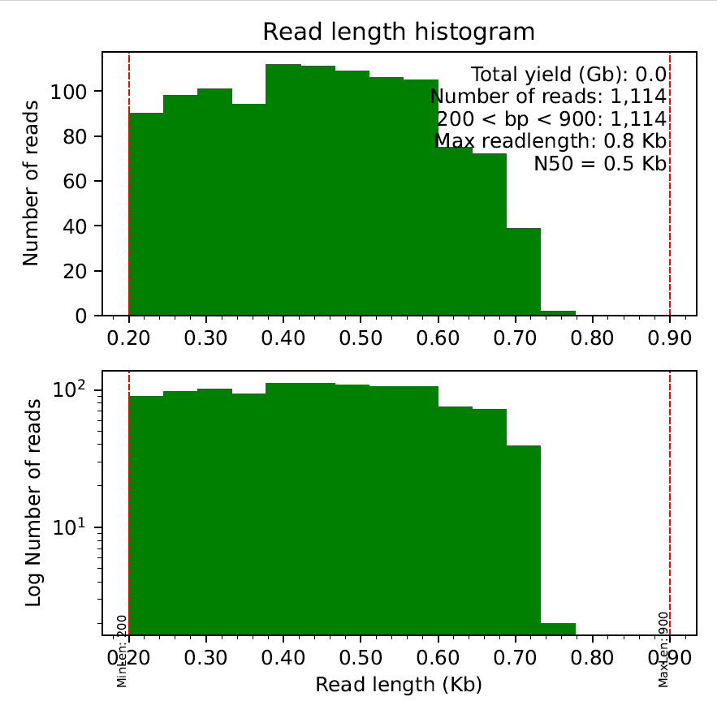
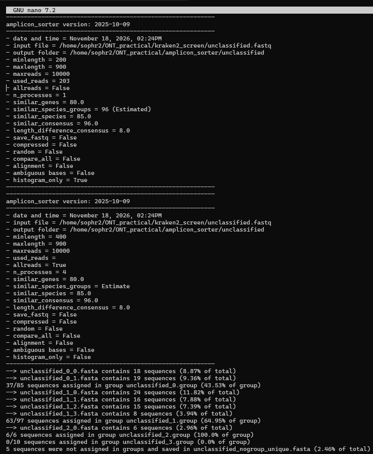

# PART 8.1: The clustering approach
{: .no_toc }

<details open markdown="block">
  <summary>
    Table of contents
  </summary>
  {: .text-delta }
- TOC
{:toc}
</details>

---

There is an alternative approach to mapping reads to a reference, and that is a clustering approach.


<small>Simple diagram of a clustering approach</small>

Rather than mapping reads to a known reference sequence, the clustering approach groups all reads based on sequence similarity and length without needing a reference. Reads that are sufficiently similar to each other are grouped together, and a consensus sequence is built for each group. The limit for separating closely related species is currently around 95-96% similarity. This means that your sample should ideally only produce one cluster from the unclassified reads produced in the Kraken2 run, as each sample should contain reads from one target species. However, this is not always the case - factors such as contamination not identified by Kraken2, read length variability, and sequencing errors may result in multiple clusters being produced.

## Amplicon Sorter

We will use a program called [Amplicon Sorter](https://github.com/avierstr/amplicon_sorter), which clusters ONT sequences based on their similarity in sequence and length, and builds a consensus sequence for each group.

For a more in-depth understanding of how Amplicon Sorter works in practice, here is the 
workflow diagram from their [GitHub](https://github.com/avierstr/amplicon_sorter):



### Running amplicon sorter

First, create a directory for the output:

```bash
mkdir ~/ONT_practical/amplicon_sorter
```

Before running the full clustering, it's worth checking how many of your reads fall within the expected size range for COI (~650 bp). Run Amplicon Sorter with the `-ho` flag to generate a read length histogram only, before you do this, make sure you are in your newly created directory (`cd ~/ONT_practical/amplicon_sorter`):

```bash
python3 /hpc/groups/icl-msc-tbe/2026-dec/amplicon_sorter/amplicon_sorter.py -i ~/ONT_practical/kraken2_screen/unclassified.fastq -o ~/ONT_practical/amplicon_sorter -min 200 -max 900 -ho
```

The `-min` and `-max` values filter out reads shorter than 200 bp and longer than 900 bp. We expect a full COI sequence to be ~650 bp, so this range allows for fragmented or slightly longer reads.

Check your output directory for the histogram PDF:

```bash
ls ~/ONT_practical/amplicon_sorter
```

You should see `unclassified_total_outputfig.pdf`. Transfer it to your local computer using WinSCP and open it if you can, it should look like this:


<small>Example Amplicon Sorter histogram output</small>

{: .highlight }
> **[Q]**  
> 1. How many sequences fall within your `min` and `max` threshold? The result will also be printed to the terminal if you cannot access the histogram PDF.

Now you have had a look at your size threshold, run the full clustering, this may take a few minutes:

```bash
python3 /hpc/groups/icl-msc-tbe/2026-dec/amplicon_sorter/amplicon_sorter.py -i ~/ONT_practical/kraken2_screen/unclassified.fastq -o ~/ONT_practical/amplicon_sorter -min 200 -max 800 -ar -a -ldc 150 -aln -np 4
```

- `-i` is for your input FASTQ file.
- `-o` if where you define your output directory through a file path.
- `-min` / `-max` are the minimum and maximum read length to process.
- `-ar` is telling the run to use all reads between the length limits (the default is running the first 10,000 reads). 
- `-a` compares all reads together, rather than default just using a subset of reads.
- `-ldc 150` tells Amplicon Sorter to combine groups whose consensus sequences differ in length by up to 150% (essentially allowing a short partial read (e.g. 300 bp length) and a longer read (e.g. 750 bp length) to be merged into the same group).
- `-aln` outputs the read alignment that was used to build each consensus sequence (alignment of all reads within a cluster).
- `-np 4` is 4 CPU cores to speed up processing.

This may take several minutes to run. You will see progress information printed to the terminal as it processes. When complete, list the output files:

```bash
ls ~/ONT_practical/amplicon_sorter
```

Key output files to look for:

| File | Description |
|---|---|
| `unclassified_0_0.fasta` | Reads and consensus for cluster 0 |
| `unclassified_0_1.fasta` | Reads and consensus for cluster 1 (if present) |
| `unclassified_consensusfile.fasta` | All consensus sequences in one file |
| `unclassified_total_outputfig.pdf` | Read length histogram |
| `results.txt` | Settings used and % of reads assigned to groups |

Have a look at your `results.txt` in the terminal. Make sure you are in your `amplicon_sorter` directory by typing `pwd` to check, or change directory with `cd ~/ONT_practical/amplicon_sorter`:

```bash
nano unclassified/results.txt
```

This is what it should look like:



Type `ctrl + x` when you want to exit nano.


{: .highlight }
> **[Q]**  
> Looking at the terminal output and `results.txt`:
> 1. How many clusters were found?
> 2. If you got multiple clusters, why do you think that is? (If you are unsure please feel free to ask one of us!)
> 3. What percentage of your reads were assigned to a group?


