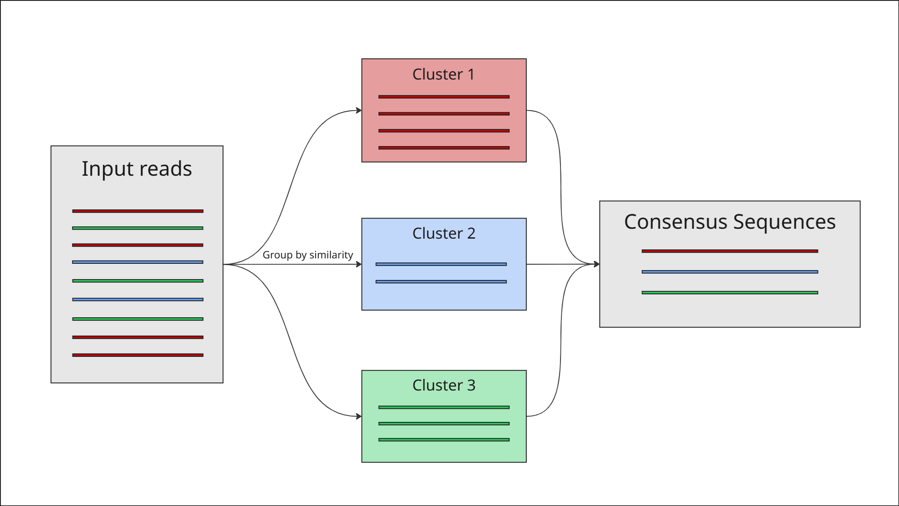
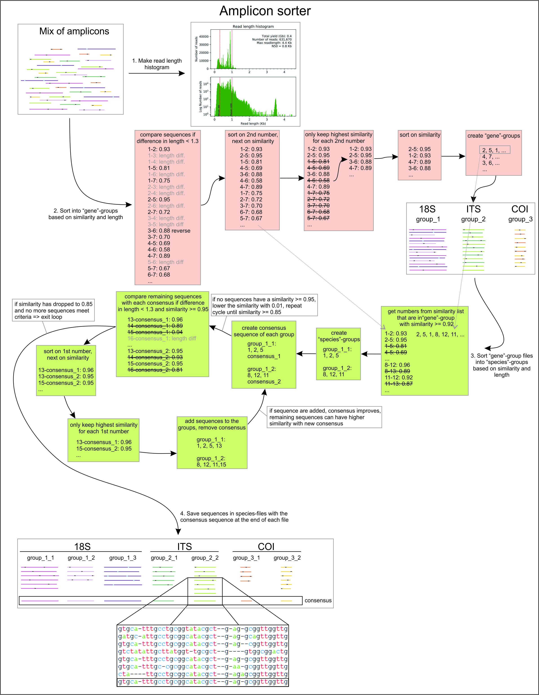

# PART 8.1: The clustering approach

---

There is an alternative approach to mapping reads to a reference, and that is a clustering approach.


*Simple diagram of a clustering approach*

Rather than mapping reads to a known reference sequence, the clustering approach groups all reads based on sequence similarity and length without needing a reference. Reads that are sufficiently similar to each other are grouped together, and a consensus sequence is built for each group. The limit for separating closely related species is currently around 9596% similarity.

This is done using a program called [Amplicon Sorter](https://github.com/avierstr/amplicon_sorter), which clusters ONT sequences based on their similarity in sequence and length, and builds a consensus sequence for each group.

For a more in-depth understanding of how Amplicon Sorter works in practice, here is the 
workflow diagram from their [GitHub](https://github.com/avierstr/amplicon_sorter) 
([Vierstraete & Braeckman, 2022](https://doi.org/10.1002/ece3.8603)):



First, create a directory for the output:

```bash
mkdir ~/ONT_practical/amplicon_sorter
```

Before running the full clustering, it's worth checking how many of your reads fall within the expected size range for COI (~650 bp). Run Amplicon Sorter with the `-ho` flag to generate a read length histogram only:

```bash
python3 /hpc/groups/icl-msc-tbe/2026-dec/amplicon_sorter.py -i ~/ONT_practical/kraken2_screen/unclassified.fastq -o ~/ONT_practical/amplicon_sorter -min 400 -max 900 -ho
```

The `-min` and `-max` values filter out reads shorter than `400` bp and longer than `900` bp. We expect a full COI sequence to be ~650 bp, so this range allows for fragmented or slightly longer reads.

Check your output directory for the histogram PDF:

```bash
ls ~/ONT_practical/amplicon_sorter
```

You should see `unclassified_total_outputfig.pdf`. Transfer it to your local computer using WinSCP and open it if you can, it should look like this:


*I will fill this in during the test data run as an example output histogram*

{: .note }
**[Q]**  
1. How many reads fall within your `min` and `max` threshold? The result will also be printed to the terminal if you cannot access the histogram PDF.

Now you have had a look at your size threshold, run the full clustering:

```bash
python3 /hpc/groups/icl-msc-tbe/2026-dec/amplicon_sorter.py -i ~/ONT_practical/kraken2_screen/unclassified.fastq -o ~/ONT_practical/amplicon_sorter -min 400 -max 900 -ar -np 4
```

`-i` is for your input FASTQ file, `-o` if where you define your output directory through a file path, `-min` / `-max` are the minimum and maximum read length to process, `-ar` is telling the run to use all reads between the length limits (the default is running the first 10,000 reads), and `-np 4` is 4 CPU cores to speed up processing.

This may take several minutes to run. You will see progress information printed to the terminal as it processes. When complete, list the output files:

```bash
ls ~/ONT_practical/amplicon_sorter
```
Have a look at your `results.txt` in the terminal. Make sure you are in your `amplicon_sorter` directory by typing `pwd` to check, or change directory with `cd ~/ONT_practical/amplicon_sorter`:

```bash
nano results.txt
```

Type `ctrl + x` when you want to exit nano.

{: .note }
**[Q]**  
Looking at the terminal output and `results.txt`:
1. How many clusters were found?
2. What percentage of your reads were assigned to a cluster?
3. How does this compare to the number of reads that mapped to the reference in PART 7?


