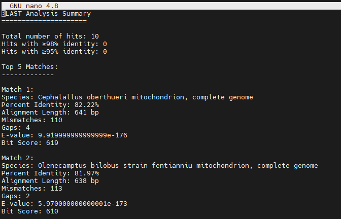
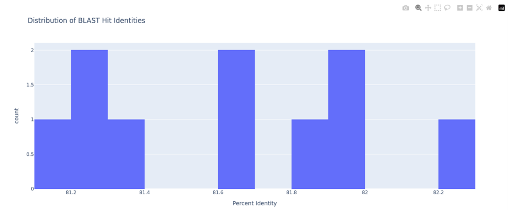
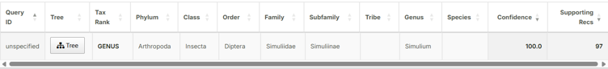

# PART 9: Species validation through sequence similarity searching

---

In this last section, we will perform molecular identification of our sequences using [BLASTn](https://blast.ncbi.nlm.nih.gov/Blast.cgi) (Basic Local Alignment Search Tool against the nucleotide database). You can use both tools via their respective webservers, but in-keeping with the CLI nature of this practical, let's build a database and run the search locally (via our terminals).
By comparing our consensus sequence(s) against an existing and well-curated sequence database, we can validate the species identity of our samples through sequence similarity. This step is crucial for confirming our taxonomic assignments and ensuring we've accurately identified our target species (or close to it). Local BLASTn searches will allow us to compare our sequences against known reference sequences, providing a robust method for species validation.

{: .note }
You will need to run the mapping-based consensus sequence you produced through this section first, and then go through part 9 again substituting the filenames and paths for your clustering-based consensus sequence!

As we're interested in COI, we will download just the mitochondrial database from NCBI (a subset of the entire nucleotide database containing solely mitochondrial genomes). First, let's return to our `hpc/users/[YOUR_USERNAME]` (i.e. practical directory) (using `cd ..`) and create a directory to store the database files.

```bash
mkdir blast_mito_db
```

Then enter that directory (using `cd blast_mito_db`), and run this perl script (denoted by `.pl`) provided by NCBI in their 'BLAST' package, which was downloaded when we created our conda environment.
`--decompress` tells it to automatically decompress the downloaded files, and `mito` specifies the database to download. Fifteen files will be downloaded, including several nucleotide and taxonomy database files, and checksums (to ensure the integrity of the download). This might take a couple of minutes.

```bash
update_blastdb.pl --decompress mito
```

Once it's finished downloading and decompressing the files (it may take a couple of minutes), return to your practical directory (`cd ..`). Now we can run our local BLAST nucleotide (BLASTn) similarity search against this mitochondrial sequence database in order to classify your reads that mapped to the COI reference sequence (and went on to form your consensus sequence). As always, let's create a directory for those results to go into.

```bash
mkdir blast_mito_results
```

Now we can run our BLASTn command! We will call the command with `blastn`, using the following flags:

- `-query` to specify our input as our mapped reads in FASTA format
- `-db` to specify the mitochondrial sequence database we created and which we will search against
- `-outfmt 6` to list the BLAST search results in tabular format (denoted by `6`) with the following column headings (e.g. `pident` = Percentage identity of the match)
- `-out` to specify where we want to output the results to, in this case `blast_results/blast_mito_results.txt`

```bash
blastn -query mapping/[REF_FILENAME]-COI_consensus.fasta -db blast_mito_db/mito -outfmt "6 qseqid sseqid pident length mismatch gapopen qstart qend sstart send evalue bitscore stitle" -out blast_mito_results/[REF_FILENAME]-blast_mito_results.txt
```

Despite specifying the output format and column headings, the results are not in a particularly human-friendly format, so we will use a simple custom python script that will inspect the BLASTn results, parse them into a nicer format, and create some simple plots to summarise the results.
First, copy the `parse_blast_results.py` script from `/hpc/groups/icl-msc-tbe/2026/` to your practical directory using:

```bash
cp /hpc/groups/icl-msc-tbe/parse_blast_results.py .
```

Then call the script using the following command.
The `--input` flag is used to specify our 'raw' BLASTn results file, and `--outdir` is used to tell the script where to output the results to, in this case the same `blast_mito_results` directory as the input file plus a subdirectory for the specific reference used to map and construct the consensus sequence.

```bash
python parse_blast_results.py --input blast_mito_results/[REF_FILENAME]-blast_mito_results.txt --outdir blast_mito_results/[REF_FILENAME]/
```

The script may take a minute or two to run, and will output five files, two files summarising the results, and three plots (in html format):

- `blast_analysis.txt`
- `top_hits_summary.csv`
- `top_hits.html`
- `identity_distribution.html`
- `evalue_vs_identity.html`

Now enter the `blast_mito_results/[REF_FILENAME]/` directory (using `cd blast_mito_results/[REF_FILENAME]`) and examine the BLAST results (using `ls` to list the files that were created).
The most useful file output by the script will likely be `blast_analysis.txt`, view this file using the `nano` command (`nano blast_analysis.txt`). This file will look something like this:



And shows you:

- The total number of hits (i.e. matches) against sequences in the mitochondrial database
- The number of hits that had percent identity scores over 95% and 97%, where percent identity is the percentage of identical matches between your query sequence aligned to the database sequence. For example, if you have a 100 bp alignment and 95 bases match exactly = 95% identity. Generally, for species identification you want >97% percent identity values and genus-level identification you want >95% identity, although this is a loose 'rule of thumb' and differs considerably across the tree of life.
- A summary of the top 5 hits, including the name of the match (species), the percent identity, the total length of your reads aligned against that target, the number of mismatched (i.e. different) bases, the number of gaps in the alignment (possible formed from insertions or deletions in your sequence data in comparison to the reference), the E-value (i.e. expectation value, the lower the better), and Bit score (normalised score, where higher = better matches).

It's also worth having a look at some of the plots you generated, which you'll need to move the HTML file (e.g. `identity_distribution.html`) to your local computer for, using WinSCP/Filezilla/etc.
For example, `identity_distribution.html` might look something like this:



{: .note }
**[Q]**  
Looking at the BLASTn search results:
- How many hits did you get in total?
- How many high-identity (>97%) matches did you get?
- What taxon was your top match, and what was the percent identity of this match?
- Is the top hit species the one you expected based on the morphological identification of your beetle specimen?
  - If not, copy the name of the top hit species, and search it in the [NCBI taxonomy database](https://www.ncbi.nlm.nih.gov/datasets/taxonomy/). Also do this for the species it was identified as morphologically. How taxonomically diverged (i.e. far away from each other) are they? Do they share the same genus, family, superfamily, etc?
- Your top 5 hits might include multiple species with >97% identity. What does this tell you about species boundaries in this group?
- Why might BLAST percent identity not always reliably distinguish closely related species?

**Please record which species you got for the top hit/match, and let us know!**

---

As well as querying NCBI's mitochondrial database, the BLAST+ suite of tools enables you to create BLAST-format databases from just a FASTA file, meaning the database possibilities are endless. There are also many other pre-made databases you could classify your barcode consensus sequence against.

Let us also look for similar sequences in NCBI's entire `core_nt` (core nucleotide) database, which can easily be done for one sequence [via the web](https://blast.ncbi.nlm.nih.gov/Blast.cgi?PROGRAM=blastn&BLAST_SPEC=GeoBlast&PAGE_TYPE=BlastSearch). Copy your consensus sequence from the FASTA file, paste it into the 'Enter Query Sequence' box, change 'Program Selection' to `blastn`, and click 'BLAST'.

{: .note }
**[Q]**  
Differences between BLAST databases:
- Did you 'hit' different taxa in your local BLASTn search against the mitochondrial database vs. the web BLASTn search against the entire `core_nt`?
- Which search was 'better'?

---

In addition to different databases, there are many other tools and ways to conduct taxonomic validation and assignment. One of these is via the Barcode of Life Database ([BOLD](https://boldsystems.org/)) Identification Engine (<https://id.boldsystems.org/>), which implements a similar sequence similarity search to BLAST, but against BOLD's curated reference libraries.

To do so, follow these steps:

1. Copy your barcode consensus sequence
2. Go to the BOLD ID engine (link above)
3. Click the 'ANIMAL SPECIES-LEVEL LIBRARY (PUBLIC + PRIVATE)' database containing ~10M curated COI barcode sequences
4. Click 'Exhaustive Search' to allow for less specific taxonomic matching
5. Paste in your COI barcode consensus sequence
6. Click 'Identify' (it will take a few minutes)!

You should see something similar to this:



{: .note }
**[Q]**  
Evaluating the BOLD ID engine results:
1. Did you get a taxonomic assignment for your barcode? If so, what taxon did it match to?
2. What taxonomic rank did the barcode sequence get assigned to? Did it resolve past/lower than family-level? If not, why do you think this may have been the case?
3. What was the confidence of the match, and how many supporting records (i.e. matches) in BOLD's database were there?
4. Does the BOLD ID engine assignment match the BLASTn results? If not, why do you think they might have matched to different taxa?

---

{: .note }
**Challenge!** 
Redo part 9 but for your Part 8.1 consensus sequences (ones that were clustered) by replacing all the file paths, please ask us for help if you get stuck!

## Conclusion

Hopefully, having completed this activity, you will have gained a better understanding of how to process third-generation nanopore data, the applications of such a technology for understanding taxonomy and biodiversity, and the difficulties and challenges in conducting such molecular work.

The tools we have used in this activity showcase some widely used tools used for such purposes, although many more exist to carry out similar tasks. Choosing the right tools for the job is paramount when performing sequence analysis!

If you have any further questions about this activity or your own applications of the skills learnt during this course, you can contact me on: D.parsons@nhm.ac.uk