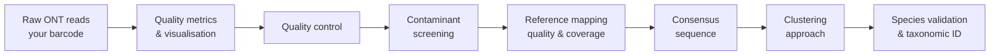

# Overview of the practical
{: .fs-9 }

From raw Oxford Nanopore reads to a species identification for your beetle.
{: .fs-6 .fw-300 }

---

## What you did in the lab

In the wet-lab practical you were each given a beetle specimen. You extracted its DNA and used PCR with universal primers to amplify the **DNA barcoding region of the mitochondrial cytochrome c oxidase I (COI) gene**.

You then prepared your COI amplicons for sequencing with Oxford Nanopore Technologies' (ONT) [Rapid Barcoding Kit 24 V14 (SQK-RBK114.24) amplicon protocol](https://nanoporetech.com/document/rapid-sequencing-v14-amplicon-sequencing-sqk-rbk114-24-or-sqk#downstream-analysis-using-epi2me). Each specimen got its own barcode, so all the samples could be pooled and sequenced together on a single R10.4.1 MinION flow cell (FLO-MIN114) on a GridION.

The rapid kit attaches barcodes by **tagmentation**: an enzyme (a transposase) cuts the DNA and tags the cut ends. This means your COI amplicons were broken into fragments during library prep. Most reads therefore cover only **part** of the amplicon rather than the whole thing. That's why today we map the reads back to a reference and combine them into a single **consensus sequence**, instead of relying on any one read.

## What you'll do today

Today you'll process and analyse the COI amplicon reads from your own specimen. You'll take them from raw basecalled reads to a quality-checked consensus barcode, then use that consensus to check your specimen's identity.

## Learning outcomes

By the end of this practical you should be able to:

- Navigate a Linux HPC environment from the command line and locate your own sequence data
- Generate, visualise and interpret quality metrics for ONT reads, before and after quality control
- Screen sequence data for contaminant sequences and explain why this matters for species identification
- Map reads to a reference, assess mapping quality and coverage, and build a consensus sequence
- Validate a specimen's identity against reference databases, and discuss why molecular and morphological IDs might disagree

## The practical in nine parts

| Part | What you'll do |
|:----:|:---------------|
| 1 | Understanding and locating your ONT amplicon sequence data |
| 2 | Generating some initial sequence quality metrics |
| 3 | Visualising raw sequence quality |
| 4 | Quality control of sequence data |
| 5 | Visualising quality-controlled sequence data |
| 6 | Screening contaminant sequences in your data |
| 7 | Reference mapping, and assessing mapping quality and coverage |
| 8 | Generating a consensus sequence from your mapped reads |
| 8.1 | The clustering approach |
| 9 | Species validation and taxonomic identification |

## How this compares with ONT's automated workflow

ONT recommends analysing data from this kit with the EPI2ME [wf-amplicon](https://github.com/epi2me-labs/wf-amplicon) workflow. It runs many of the same steps automatically and builds a de novo consensus for each barcode. Today we run similar steps one at a time, so you understand what each one does and can judge the results for yourself, rather than treating the pipeline as a black box.

{: .note }
> Remember: The goal of this practical is to understand the steps needed to analyse read (sequence) quality, experience different methods of consensus sequence generation, and recognise the purpose of this in producing amplicon data for downstream evolutionary analyses, not necessarily to obtain an amplicon of your target species. Real sequencing data can be variable, and learning to interpret and work with imperfect data is itself an important skill in bioinformatics.
